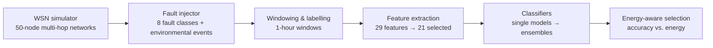

# Ensemble Learning-Based Fault Diagnosis for Wireless Sensor Networks

🚧 **Work in progress** (Week 10 of 16)

A MATLAB system that simulates multi-hop wireless sensor networks (WSNs), injects realistic sensor and communication faults, and diagnoses them with machine-learning models, building up from single classifiers to bagging, boosting and stacking ensembles with an energy-aware trade-off.

Independent study (CS 5395), Texas State University · Advisor: Dr. Hongchi Shi

## Pipeline



**Fault classes:** offset, gain, drift, stuck-at, spike, high noise, packet loss, battery depletion. Environmental events (heat or cold) are labelled normal, so the models must tell real events from faulty sensors.

## Current results

Dataset: 10 simulated networks × 50 nodes × 72 h with 270 injected faults → **6,911 labelled windows** (5,339 fault, 1,572 normal). Evaluation: 3 × grouped 5-fold cross-validation, where each test fold holds two networks the model has never seen.

| Method | Macro-F1 | Faults detected | False alarms during events |
| --- | --- | --- | --- |
| **Random forest** | **0.819 ± 0.013** | 92.7% | 17.2% |
| Neural network | 0.798 ± 0.016 | 92.1% | 15.5% |
| Decision tree | 0.796 ± 0.020 | 92.6% | 32.9% |
| SVM (RBF) | 0.772 ± 0.027 | 91.5% | 15.1% |
| Threshold rules (baseline) | 0.748 ± 0.019 | 89.1% | 27.1% |
| k-NN | 0.729 ± 0.020 | 86.5% | 17.3% |

The Friedman test rejects equal performance (p = 3 × 10⁻¹²); 13 of 15 pairwise Wilcoxon tests are significant after Holm correction. The hardest classes are offset, gain and packet loss (F1 ≈ 0.62–0.66 for every model).

## Progress

- [x] Environment check and project plan
- [x] Radio energy model and network lifetime simulation
- [x] Fault taxonomy and fault injection
- [x] Multi-hop WSN simulator (`SensorNode`, `WSNSimulator`)
- [x] Fault injection framework (`FaultInjector`, 11 unit tests)
- [x] Labelled dataset and threshold / Kalman filter baselines
- [x] Feature extraction and selection (time, frequency, wavelet, spatial)
- [x] Single models: SVM, decision tree, k-NN, random forest, neural network, with significance tests
- [ ] Bagging (random forest tuning, out-of-bag analysis)
- [ ] Boosting (AdaBoost, GentleBoost, LogitBoost, RUSBoost)
- [ ] Stacking ensemble
- [ ] Energy-aware ensemble (accuracy vs. energy Pareto frontier)
- [ ] Distributed real-time diagnosis and dashboard
- [ ] 50–200 node scalability experiments and final report

## Repository structure

```text
core/        reusable classes and functions (simulator, fault injector, training, evaluation, statistics)
tests/       unit tests
week1/ … week10/   one demo script per milestone, reproducing that week's results and figures
figures/     selected result figures
data/        generated datasets (not tracked; recreated by the scripts)
```

## Run it

Requirements: MATLAB R2026a with the Statistics and Machine Learning Toolbox. Signal Processing, Wavelet and Deep Learning Toolboxes are optional.

```matlab
addpath(genpath(pwd))
run week1/check_toolboxes.m     % verify the environment
runtests tests                  % unit tests
run week10/week10_demo.m        % latest results
```

All random seeds are fixed, so results are reproducible. The datasets in `data/` are not stored in the repository; the week 7 scripts regenerate them.

## Tech stack

MATLAB · Statistics and Machine Learning Toolbox · Signal Processing / Wavelet Toolboxes

## References

- A. Mahapatro and P. M. Khilar, "Fault diagnosis in wireless sensor networks: A survey," *IEEE Communications Surveys & Tutorials*, 2013.
- W. B. Heinzelman et al., "An application-specific protocol architecture for wireless microsensor networks," *IEEE Trans. Wireless Communications*, 2002.
- J. Demšar, "Statistical comparisons of classifiers over multiple data sets," *JMLR*, 2006.
